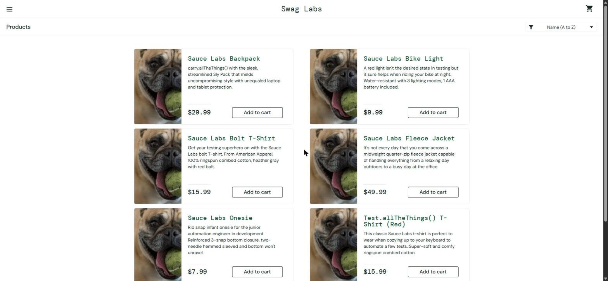

# BUG-002. [Каталог] Сортировка товаров не применяется

| Поле | Значение |
|---|---|
| Severity | Major |
| Priority | Medium |
| Модуль | Каталог |
| Пользователь | `problem_user` |
| Окружение | Windows 11, Chrome 155, окно 1920×889 |
| URL | https://www.saucedemo.com/inventory.html |
| Дата | 2026-10-12 |
| Воспроизводимость | Всегда |
| Связанный тест-кейс | [TC-INV-02](../test-cases/saucedemo-test-cases.md#tc-inv-02-сортировка-по-цене-по-возрастанию) |

## Предусловия

- Выполнен вход под `problem_user`, открыт каталог

## Шаги воспроизведения

1. В выпадающем списке сортировки выбрать «Price (low to high)»

## Фактический результат

Порядок товаров не изменился: $29.99, $9.99, $15.99, $49.99, $7.99, $15.99 (по названию A–Z). В списке сортировки снова отображается «Name (A to Z)».

## Ожидаемый результат

Товары отсортированы по возрастанию цены: $7.99, $9.99, $15.99, $15.99, $29.99, $49.99. В списке отображается «Price (low to high)».

## Вложения

## Дополнительно

Ошибок в Console нет.
