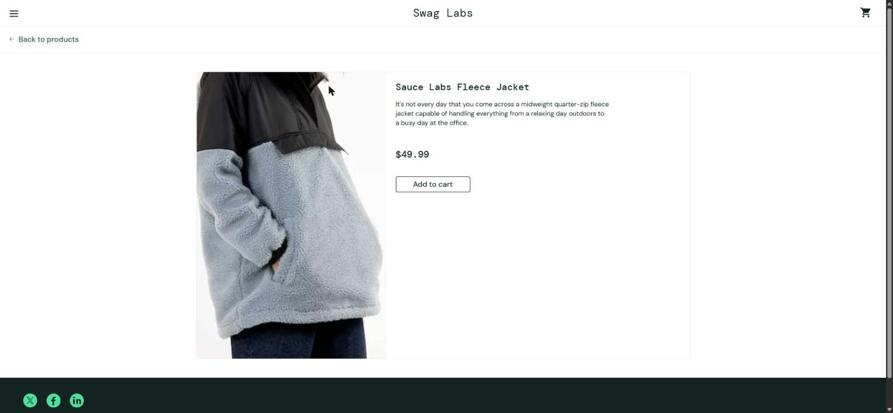

# BUG-003. [Каталог] Клик по товару открывает карточку другого товара

| Поле | Значение |
|---|---|
| Severity | Critical |
| Priority | High |
| Модуль | Каталог, карточка товара |
| Пользователь | `problem_user` |
| Окружение | Windows 11, Chrome 155, окно 1920×889 |
| URL | https://www.saucedemo.com/inventory.html |
| Дата | 2026-10-12 |
| Воспроизводимость | Всегда |
| Связанный тест-кейс | [TC-INV-04](../test-cases/saucedemo-test-cases.md#tc-inv-04-открытие-карточки-товара) |

## Предусловия

- Выполнен вход под `problem_user`, открыт каталог

## Шаги воспроизведения

1. Кликнуть по названию товара «Sauce Labs Backpack»

## Фактический результат

Открыта карточка товара «Sauce Labs Fleece Jacket» ($49.99), URL `/inventory-item.html?id=5`.

## Ожидаемый результат

Открыта карточка «Sauce Labs Backpack» ($29.99). У ссылки в каталоге id `item_4_title_link`, поэтому ожидается URL `/inventory-item.html?id=4`.

## Вложения

## Дополнительно

Пользователь может добавить в корзину не тот товар, который выбрал. Поэтому severity Critical: дефект ведет к неверному заказу.
