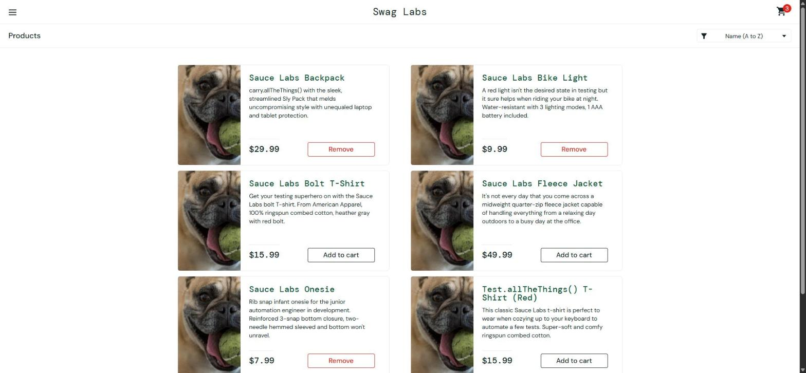

# BUG-004. [Корзина] Три товара из шести не добавляются в корзину

| Поле | Значение |
|---|---|
| Severity | Critical |
| Priority | High |
| Модуль | Каталог, корзина |
| Пользователь | `problem_user` |
| Окружение | Windows 11, Chrome 155, окно 1920×889 |
| URL | https://www.saucedemo.com/inventory.html |
| Дата | 2026-10-12 |
| Воспроизводимость | Всегда |
| Связанный тест-кейс | [TC-CART-01](../test-cases/saucedemo-test-cases.md#tc-cart-01-добавление-товара-в-корзину) |

## Предусловия

- Выполнен вход под `problem_user`, открыт каталог, корзина пуста

## Шаги воспроизведения

1. Нажать Add to cart у каждого из 6 товаров по очереди

## Фактический результат

| Товар | Счетчик корзины | Кнопка после клика |
|---|---|---|
| Sauce Labs Backpack | 0 → 1 | Remove |
| Sauce Labs Bike Light | 1 → 2 | Remove |
| Sauce Labs Bolt T-Shirt | 2 → 2 | Add to cart |
| Sauce Labs Fleece Jacket | 2 → 2 | Add to cart |
| Sauce Labs Onesie | 2 → 3 | Remove |
| Test.allTheThings() T-Shirt (Red) | 3 → 3 | Add to cart |

Bolt T-Shirt, Fleece Jacket и Test.allTheThings() T-Shirt (Red) в корзину не попадают, кнопка не реагирует.

## Ожидаемый результат

Каждый товар добавляется в корзину, счетчик доходит до 6, у всех товаров кнопка Remove.

## Вложения

## Дополнительно

Кнопка Add to cart на странице карточки Fleece Jacket тоже не добавляет товар. Ошибок в Console нет.
