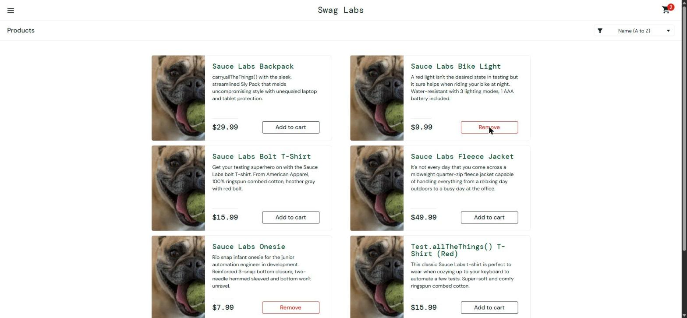

# BUG-005. [Каталог] Кнопка Remove в каталоге не удаляет товар из корзины

| Поле | Значение |
|---|---|
| Severity | Major |
| Priority | Medium |
| Модуль | Каталог, корзина |
| Пользователь | `problem_user` |
| Окружение | Windows 11, Chrome 155, окно 1920×889 |
| URL | https://www.saucedemo.com/inventory.html |
| Дата | 2026-10-12 |
| Воспроизводимость | Всегда |
| Связанный тест-кейс | [TC-CART-02](../test-cases/saucedemo-test-cases.md#tc-cart-02-удаление-товара-на-странице-корзины) |

## Предусловия

- Выполнен вход под `problem_user`
- В корзине Sauce Labs Bike Light и Sauce Labs Onesie (счетчик «2»)

## Шаги воспроизведения

1. Открыть каталог
2. Нажать Remove у товара «Sauce Labs Bike Light»

## Фактический результат

Ничего не происходит: счетчик остается «2», у товара по-прежнему кнопка Remove. Повторный клик тоже не работает.

## Ожидаемый результат

Товар удален из корзины, счетчик «1», кнопка сменилась на Add to cart.

## Вложения

## Дополнительно

Обходной путь есть: на странице корзины `/cart.html` кнопка Remove работает. Поэтому severity Major, а не Critical.
