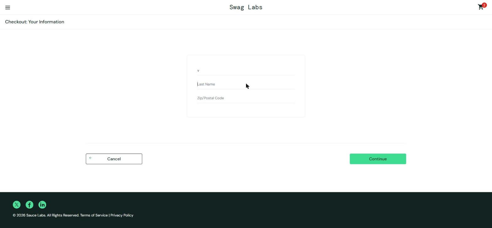
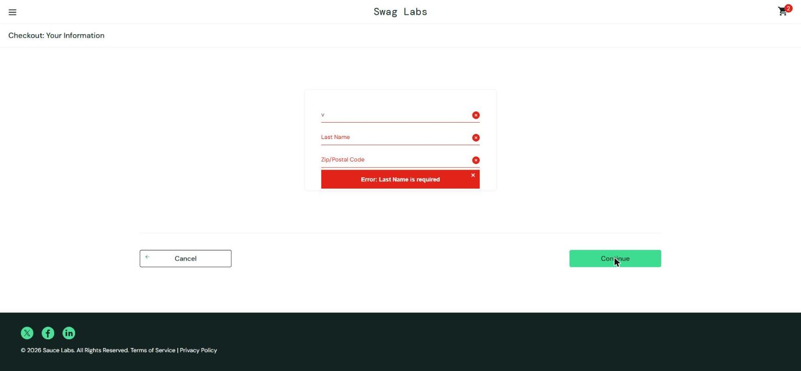

# BUG-006. [Оформление] Ввод в поле Last Name перезаписывает First Name, заказ оформить невозможно

| Поле | Значение |
|---|---|
| Severity | Blocker |
| Priority | High |
| Модуль | Оформление заказа |
| Пользователь | `problem_user` |
| Окружение | Windows 11, Chrome 155, окно 1920×889 |
| URL | https://www.saucedemo.com/checkout-step-one.html |
| Дата | 2026-10-12 |
| Воспроизводимость | Всегда |
| Связанный тест-кейс | [TC-CHK-01](../test-cases/saucedemo-test-cases.md#tc-chk-01-успешное-оформление-заказа) |

## Предусловия

- Выполнен вход под `problem_user`, в корзине есть товар
- Открыта форма Checkout: Your Information

## Шаги воспроизведения

1. Ввести `Ivan` в поле First Name
2. Перейти в поле Last Name и ввести `Petrov`
3. Нажать Continue

## Фактический результат

- После шага 1 в First Name значение `Ivan`.
- После шага 2 в First Name значение `v` (последний введенный символ), поле Last Name пустое.
- После шага 3 ошибка «Error: Last Name is required», переход к следующему шагу не выполняется.

Заполнить Last Name невозможно, поэтому `problem_user` не может оформить заказ.

## Ожидаемый результат

Текст вводится в то поле, в котором стоит курсор: First Name `Ivan`, Last Name `Petrov`. После заполнения Zip/Postal Code и нажатия Continue открывается Checkout: Overview.

## Вложения

## Дополнительно

Severity Blocker: основной сценарий магазина (покупка) недоступен, обходного пути нет. Ошибок в Console нет.
