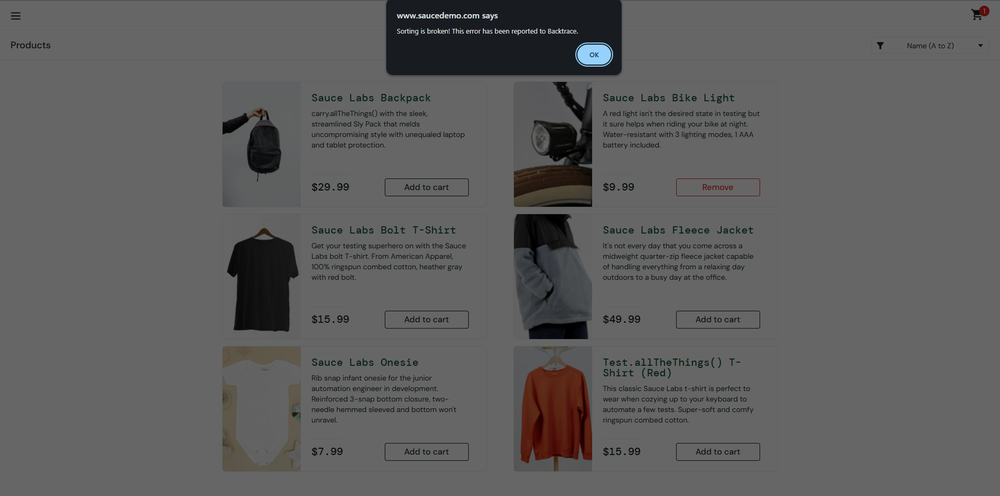

# BUG-007. [Каталог] Любая сортировка вызывает системное окно «Sorting is broken!»

| Поле | Значение |
|---|---|
| Severity | Major |
| Priority | Medium |
| Модуль | Каталог |
| Пользователь | `error_user` |
| Окружение | Windows 11, Chrome 155 |
| URL | https://www.saucedemo.com/inventory.html |
| Дата | 2026-10-12 |
| Воспроизводимость | Всегда, для любого варианта сортировки |
| Связанный тест-кейс | [TC-INV-02](../test-cases/saucedemo-test-cases.md#tc-inv-02-сортировка-по-цене-по-возрастанию), [TC-INV-03](../test-cases/saucedemo-test-cases.md#tc-inv-03-сортировка-по-названию-от-z-до-a) |

## Предусловия

- Выполнен вход под `error_user`, открыт каталог

## Шаги воспроизведения

1. В выпадающем списке сортировки выбрать «Price (low to high)»

## Фактический результат

Появляется системное окно браузера (alert): «Sorting is broken! This error has been reported to Backtrace.» После нажатия OK порядок товаров не меняется, в списке остается «Name (A to Z)». То же происходит при выборе «Name (Z to A)» и «Price (high to low)».

## Ожидаемый результат

Товары отсортированы по выбранному признаку, как под `standard_user`. Ошибки не показываются.

## Вложения

## Дополнительно

Кроме самой поломки сортировки, есть проблема интерфейса: техническое сообщение показывается пользователю через системный alert, который блокирует страницу.
