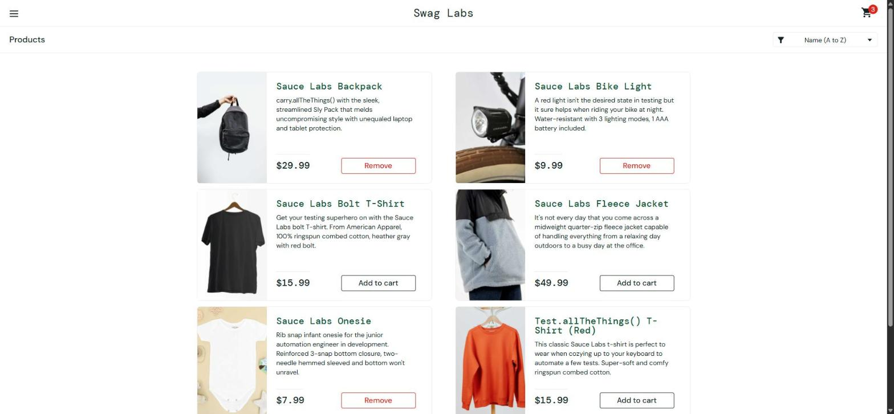

# BUG-008. [Корзина] Три товара не добавляются в корзину, в Console ошибка «Failed to add item to the cart»

| Поле | Значение |
|---|---|
| Severity | Critical |
| Priority | High |
| Модуль | Каталог, корзина |
| Пользователь | `error_user` |
| Окружение | Windows 11, Chrome 155, окно 1920×889 |
| URL | https://www.saucedemo.com/inventory.html |
| Дата | 2026-10-12 |
| Воспроизводимость | Всегда |
| Связанный тест-кейс | [TC-CART-01](../test-cases/saucedemo-test-cases.md#tc-cart-01-добавление-товара-в-корзину) |

## Предусловия

- Выполнен вход под `error_user`, открыт каталог, корзина пуста
- Открыт DevTools, вкладка Console

## Шаги воспроизведения

1. Нажать Add to cart у каждого из 6 товаров по очереди

## Фактический результат

Backpack, Bike Light и Onesie добавляются, счетчик доходит до 3. Bolt T-Shirt, Fleece Jacket и Test.allTheThings() T-Shirt (Red) не добавляются: кнопка остается Add to cart, счетчик не меняется. На каждый неудачный клик в Console появляется исключение:

```
Error: Failed to add item to the cart.
    at f (https://www.saucedemo.com/assets/index-D3OxT1jE.js:573:45848)
    at a (https://www.saucedemo.com/assets/index-D3OxT1jE.js:573:46187)
```

Пользователь никакого сообщения об ошибке не видит.

## Ожидаемый результат

Все 6 товаров добавляются в корзину, счетчик «6». Если добавить товар не удалось, пользователь видит понятное сообщение.

## Вложения



## Дополнительно

Те же три товара не добавляются под `problem_user` ([BUG-004](BUG-004.md)), но там ошибки в Console нет. Возможно, у дефектов общая причина.
