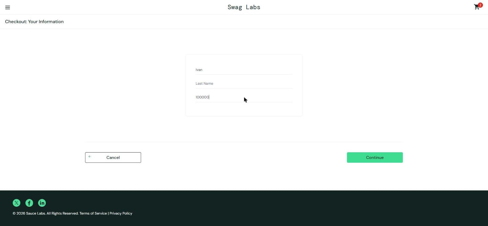

# BUG-011. [Оформление] Форма пропускает пустое обязательное поле Last Name

| Поле | Значение |
|---|---|
| Severity | Major |
| Priority | Medium |
| Модуль | Оформление заказа |
| Пользователь | `error_user` |
| Окружение | Windows 11, Chrome 155, окно 1920×889 |
| URL | https://www.saucedemo.com/checkout-step-one.html |
| Дата | 2026-10-12 |
| Воспроизводимость | Всегда |
| Связанный тест-кейс | [TC-CHK-02](../test-cases/saucedemo-test-cases.md#tc-chk-02-пустое-поле-first-name) (аналог для Last Name) |

## Предусловия

- Выполнен вход под `error_user`, в корзине есть товар
- Открыта форма Checkout: Your Information

## Шаги воспроизведения

1. Ввести `Ivan` в поле First Name
2. Оставить поле Last Name пустым
3. Ввести `100000` в поле Zip/Postal Code
4. Нажать Continue

## Фактический результат

Открывается Checkout: Overview без ошибки. Заказ продолжает оформляться без фамилии.

## Ожидаемый результат

Переход не выполняется, показано сообщение «Error: Last Name is required», как под `standard_user`.

## Вложения

## Дополнительно

Под `problem_user` проверка обязательного поля работает ([BUG-006](BUG-006.md)), то есть дефект касается именно `error_user`.
