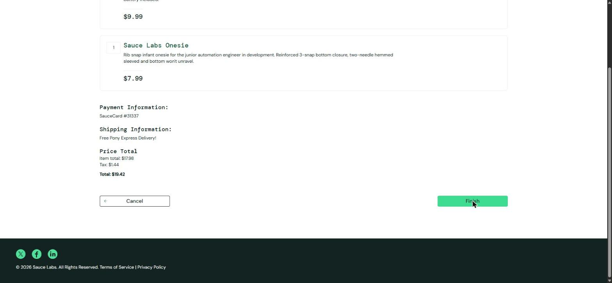

# BUG-012. [Оформление] Кнопка Finish не завершает заказ, в Console TypeError

| Поле | Значение |
|---|---|
| Severity | Blocker |
| Priority | High |
| Модуль | Оформление заказа |
| Пользователь | `error_user` |
| Окружение | Windows 11, Chrome 155, окно 1920×889 |
| URL | https://www.saucedemo.com/checkout-step-two.html |
| Дата | 2026-10-12 |
| Воспроизводимость | Всегда |
| Связанный тест-кейс | [TC-CHK-01](../test-cases/saucedemo-test-cases.md#tc-chk-01-успешное-оформление-заказа) |

## Предусловия

- Выполнен вход под `error_user`
- В корзине Sauce Labs Bike Light и Sauce Labs Onesie
- Пройден шаг Checkout: Your Information, открыт Checkout: Overview
- Открыт DevTools, вкладка Console

## Шаги воспроизведения

1. Нажать Finish

## Фактический результат

Страница не меняется, остается Checkout: Overview. Счетчик корзины «2», товары остаются в корзине. Пользователь не видит никакого сообщения. В Console исключение:

```
TypeError: La.cesetRart is not a function
    at n (https://www.saucedemo.com/assets/index-D3OxT1jE.js:573:15947)
    at onClick (https://www.saucedemo.com/assets/index-D3OxT1jE.js:573:18122)
```

## Ожидаемый результат

Открыта страница Checkout: Complete! с текстом «Thank you for your order!», корзина пуста.

## Вложения



## Дополнительно

Имя функции `cesetRart` похоже на опечатку в `resetCart`: обработчик Finish вызывает несуществующую функцию очистки корзины. Severity Blocker: покупку завершить невозможно, обходного пути нет. Суммы на странице обзора рассчитаны верно: Item total $17.98, Tax $1.44 (8%), Total $19.42.
