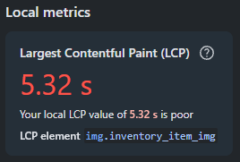
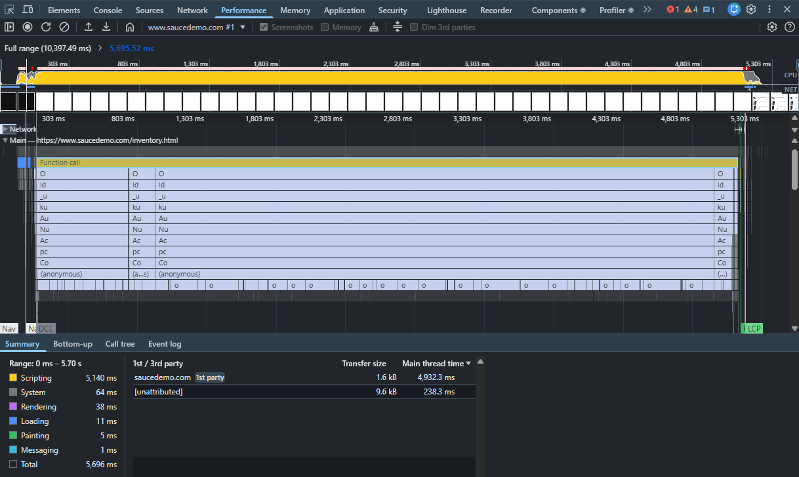
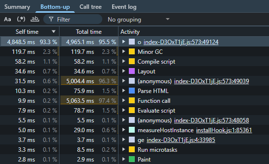
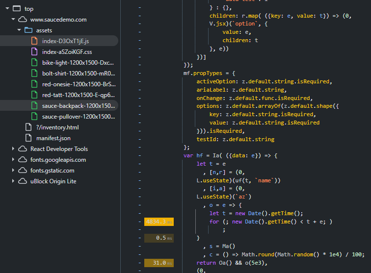

# BUG-020. [Каталог] Каталог открывается около 5 секунд: страницу блокирует синхронный цикл ожидания

| Поле | Значение |
|---|---|
| Severity | Major |
| Priority | High |
| Модуль | Каталог, производительность |
| Пользователь | `performance_glitch_user` |
| Окружение | Windows 11, Chrome 155, DevTools: Performance, Sources |
| URL | https://www.saucedemo.com/inventory.html |
| Дата | 2026-10-12 |
| Воспроизводимость | Всегда, при каждом открытии каталога |
| Связанный тест-кейс | [TC-LOGIN-01](../test-cases/saucedemo-test-cases.md#tc-login-01-успешный-вход-с-валидными-данными), [TC-INV-04](../test-cases/saucedemo-test-cases.md#tc-inv-04-открытие-карточки-товара) |

## Предусловия

- Открыта страница входа
- Открыт DevTools, вкладка Performance

## Шаги воспроизведения

1. Войти под `performance_glitch_user`
2. Дождаться каталога
3. Открыть карточку любого товара
4. Нажать Back to products

## Фактический результат

- После шага 1 каталог появляется примерно через 5 секунд. Все это время страница не реагирует на действия пользователя.
- После шага 4 та же задержка около 5 секунд.
- Largest Contentful Paint 5.32 s (оценка Chrome: poor), LCP-элемент `img.inventory_item_img`.
- В записи Performance главный поток занят одной задачей `Function call` на 5.7 s, из них Scripting 5 140 ms.
- Во вкладке Bottom-up 93% времени (4 848 ms) приходится на функцию `o` в `index-D3OxT1jE.js:573`.
- В Sources видно, что функция `o` выполняет пустой цикл до истечения заданного времени и вызывается при отрисовке каталога как `o(5e3)`, то есть на 5000 ms:

```js
o = e => {
  let t = new Date().getTime();
  for (; new Date().getTime() < t + e; );
}
```

## Ожидаемый результат

Каталог открывается так же быстро, как под `standard_user`, без заметной задержки. LCP не более 2.5 s (порог «good» в Chrome).

## Вложения









## Дополнительно

Задержка возникает при каждой отрисовке компонента каталога, поэтому вход и возврат на предыдущую страницу описаны в одном репорте: причина одна. Синхронный цикл блокирует главный поток, поэтому страница не просто грузится медленно, а полностью зависает: клики и прокрутка не обрабатываются.
