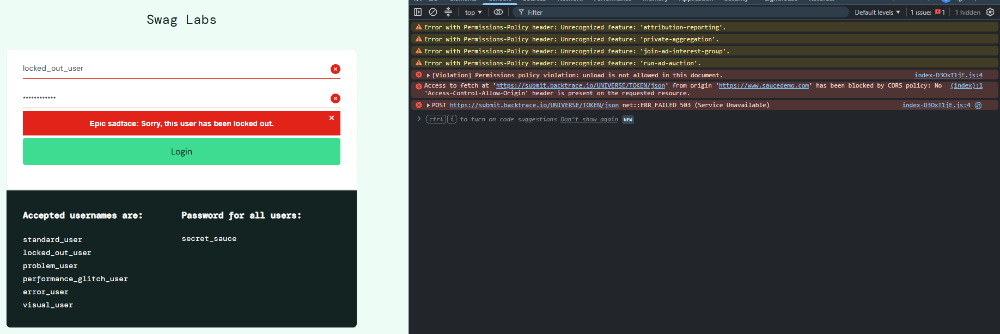
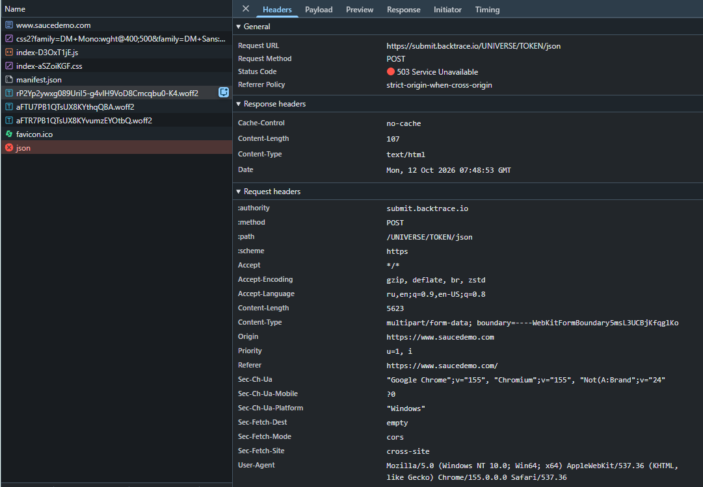

# BUG-021. [Мониторинг] Отчеты об ошибках не доходят до Backtrace: в URL незаполненные UNIVERSE и TOKEN

| Поле | Значение |
|---|---|
| Severity | Major |
| Priority | Medium |
| Модуль | Мониторинг ошибок (интеграция с Backtrace) |
| Пользователь | `locked_out_user` (воспроизводится при любой ошибке на клиенте) |
| Окружение | Windows 11, Chrome 155, DevTools: Console, Network |
| URL | https://www.saucedemo.com/ |
| Дата | 2026-10-12 |
| Воспроизводимость | Всегда |
| Связанный тест-кейс | [TC-LOGIN-05](../test-cases/saucedemo-test-cases.md#tc-login-05-вход-заблокированного-пользователя) |

## Предусловия

- Открыта страница входа
- Открыт DevTools, вкладки Console и Network

## Шаги воспроизведения

1. Ввести `locked_out_user` и `secret_sauce`
2. Нажать Login
3. Посмотреть Console и запрос `json` в Network

## Фактический результат

Для пользователя все верно: показано «Epic sadface: Sorry, this user has been locked out.»

При этом приложение пытается отправить отчет об ошибке в Backtrace, и отправка не проходит:

- Запрос `POST https://submit.backtrace.io/UNIVERSE/TOKEN/json` возвращает **503 Service Unavailable**.
- В Console ошибка CORS: «Access to fetch at 'https://submit.backtrace.io/UNIVERSE/TOKEN/json' from origin 'https://www.saucedemo.com' has been blocked by CORS policy: No 'Access-Control-Allow-Origin' header is present on the requested resource.»
- В URL вместо имени аккаунта и токена Backtrace стоят заглушки `UNIVERSE` и `TOKEN`: интеграция не настроена.

## Ожидаемый результат

Отчет об ошибке уходит на настроенный адрес Backtrace с реальным аккаунтом и токеном, сервер отвечает 200, ошибок CORS нет.

## Вложения

## Дополнительно

Пользователь дефекта не видит, но команда не получает ни одного отчета об ошибках с клиента, то есть не узнает о падениях вроде [BUG-012](BUG-012.md). При этом сообщение из [BUG-007](BUG-007.md) говорит пользователю «This error has been reported to Backtrace», что не соответствует действительности.
