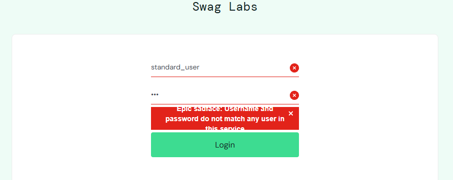
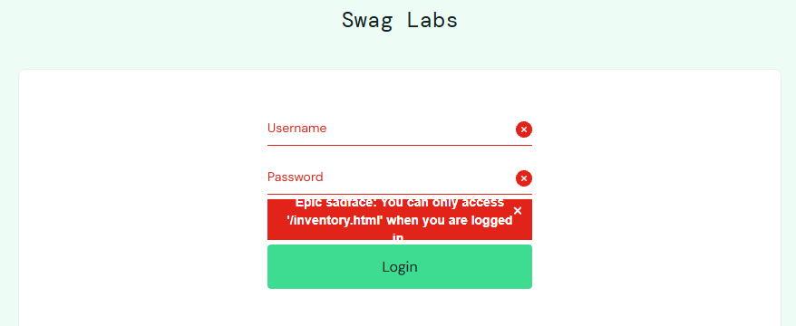

# BUG-022. [Логин] Длинное сообщение об ошибке обрезается сверху и снизу

| Поле | Значение |
|---|---|
| Severity | Minor |
| Priority | Medium |
| Модуль | Логин |
| Пользователь | `standard_user`, неавторизованный пользователь |
| Окружение | Windows 11, Chrome 155 |
| URL | https://www.saucedemo.com/ |
| Дата | 2026-10-12 |
| Воспроизводимость | Всегда, для сообщений длиннее одной строки |
| Связанный тест-кейс | [TC-LOGIN-02](../test-cases/saucedemo-test-cases.md#tc-login-02-вход-с-неверным-паролем), [TC-LOGIN-06](../test-cases/saucedemo-test-cases.md#tc-login-06-доступ-к-каталогу-без-авторизации) |

## Шаги воспроизведения

**Вариант 1**

1. Ввести `standard_user` и неверный пароль
2. Нажать Login

**Вариант 2**

1. Не входя в систему, открыть `https://www.saucedemo.com/inventory.html`

## Фактический результат

Сообщение не помещается в красную плашку: первая и последняя строки срезаны по высоте.

- Вариант 1: «Epic sadface: Username and password do not match any user in this service», видна только средняя строка.
- Вариант 2: «Epic sadface: You can only access '/inventory.html' when you are logged in», срезаны верх и низ.

Короткие сообщения в одну строку («Username is required», «Password is required») отображаются полностью.

## Ожидаемый результат

Плашка увеличивается по высоте под текст, сообщение читается полностью.

## Вложения

## Дополнительно

Priority Medium: сообщение об ошибке входа видит каждый пользователь, который ошибся паролем.
