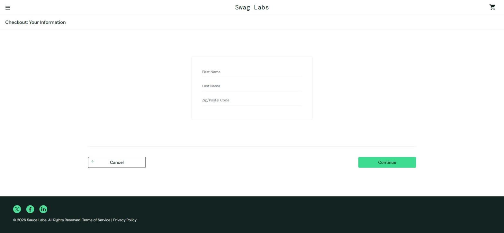
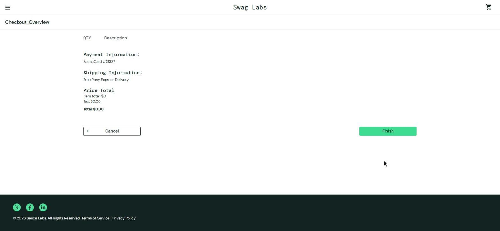
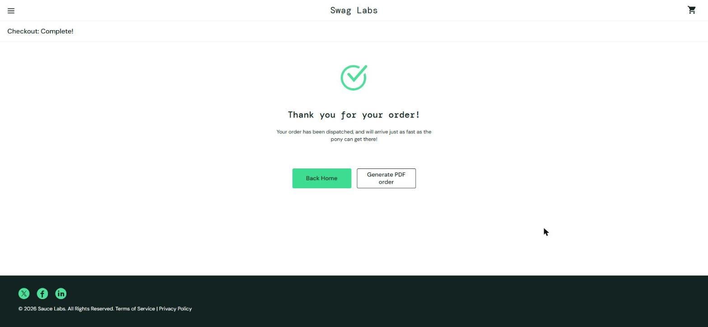

# BUG-023. [Оформление] Можно оформить заказ с пустой корзиной

| Поле | Значение |
|---|---|
| Severity | Major |
| Priority | Medium |
| Модуль | Корзина, оформление заказа |
| Пользователь | `standard_user` |
| Окружение | Windows 11, Chrome 155, окно 1920×889 |
| URL | https://www.saucedemo.com/cart.html |
| Дата | 2026-10-12 |
| Воспроизводимость | Всегда |
| Связанный тест-кейс | [TC-CHK-05](../test-cases/saucedemo-test-cases.md#tc-chk-05-оформление-заказа-с-пустой-корзиной) |

## Предусловия

- Выполнен вход под `standard_user`, корзина пуста

## Шаги воспроизведения

1. Открыть корзину
2. Нажать Checkout
3. Ввести First Name `Ivan`, Last Name `Petrov`, Zip/Postal Code `100000`, нажать Continue
4. Нажать Finish

## Фактический результат

- Шаг 2: открывается форма Checkout: Your Information, хотя корзина пуста.
- Шаг 3: открывается Checkout: Overview без товаров: Item total $0, Tax $0.00, Total $0.00.
- Шаг 4: страница «Thank you for your order!» и сообщение «Your order has been dispatched». Пустой заказ оформлен и «отправлен».

## Ожидаемый результат

При пустой корзине кнопка Checkout неактивна или показывается сообщение «Корзина пуста». Оформить заказ без товаров невозможно.

## Вложения

## Дополнительно

В реальном магазине такие заказы попадают в учет и обработку как настоящие. Дефект воспроизводится под эталонным пользователем, значит, затрагивает всех покупателей.
