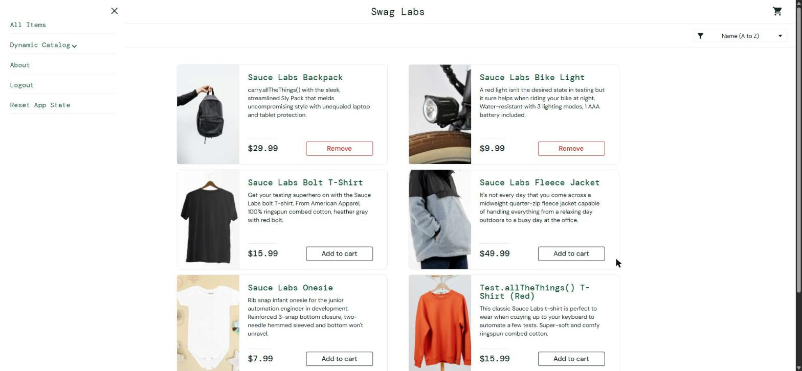

# BUG-024. [Меню] После Reset App State у товаров остаются кнопки Remove

| Поле | Значение |
|---|---|
| Severity | Minor |
| Priority | Medium |
| Модуль | Меню, каталог |
| Пользователь | `standard_user` |
| Окружение | Windows 11, Chrome 155, окно 1920×889 |
| URL | https://www.saucedemo.com/inventory.html |
| Дата | 2026-10-12 |
| Воспроизводимость | Всегда |
| Связанный тест-кейс | [TC-MENU-02](../test-cases/saucedemo-test-cases.md#tc-menu-02-reset-app-state-очищает-корзину) |

## Предусловия

- Выполнен вход под `standard_user`
- В корзину добавлены Sauce Labs Backpack и Sauce Labs Bike Light, счетчик «2»

## Шаги воспроизведения

1. Открыть меню (иконка слева вверху)
2. Нажать Reset App State
3. Не обновляя страницу, посмотреть на кнопки товаров в каталоге

## Фактический результат

- Счетчик корзины исчез, `cart-contents` в localStorage удален: корзина действительно очищена.
- У Sauce Labs Backpack и Sauce Labs Bike Light по-прежнему кнопка Remove, хотя этих товаров в корзине уже нет.

Состояние интерфейса расходится с данными: пользователь видит, что товары в корзине, а корзина пуста.

## Ожидаемый результат

После Reset App State у всех товаров кнопка Add to cart без обновления страницы.

## Вложения

## Дополнительно

Сброс очищает данные корзины, но не обновляет состояние кнопок в уже отрисованном каталоге.
