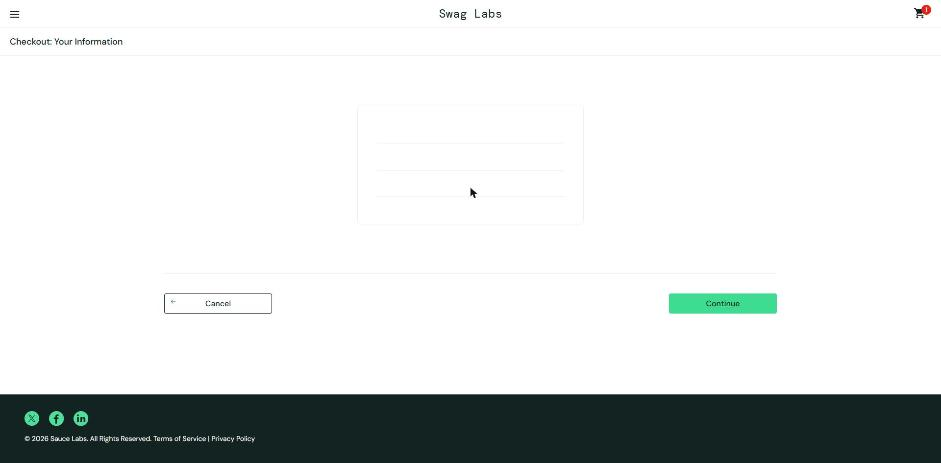
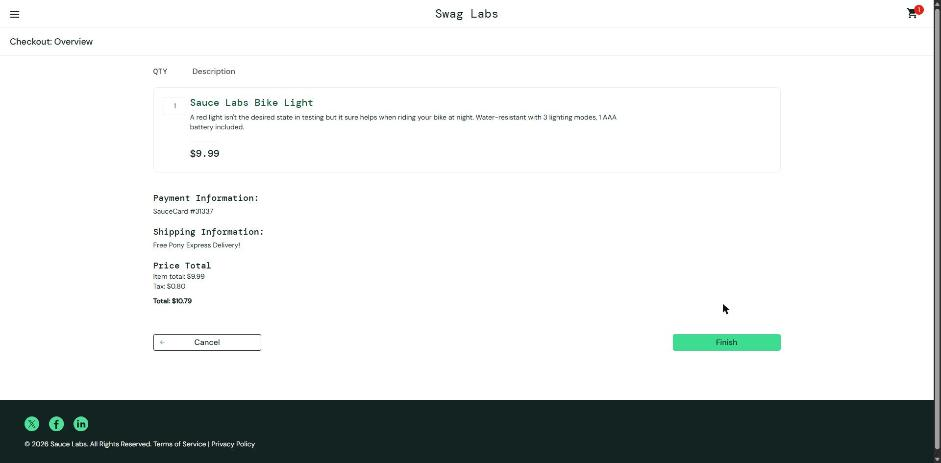

# BUG-026. [Оформление] Поля из одних пробелов проходят проверку обязательности

| Поле | Значение |
|---|---|
| Severity | Major |
| Priority | Medium |
| Модуль | Оформление заказа |
| Пользователь | `standard_user` |
| Окружение | Windows 11, Chrome 155 |
| URL | https://www.saucedemo.com/checkout-step-one.html |
| Дата | 2026-10-12 |
| Воспроизводимость | Всегда |
| Связанный тест-кейс | [TC-CHK-02](../test-cases/saucedemo-test-cases.md#tc-chk-02-пустое-поле-first-name), чек-лист п. 5.6 |

## Предусловия

- Выполнен вход под `standard_user`, в корзине есть товар
- Открыта форма Checkout: Your Information

## Шаги воспроизведения

1. Ввести три пробела в поле First Name
2. Ввести три пробела в поле Last Name
3. Ввести три пробела в поле Zip/Postal Code
4. Нажать Continue

## Фактический результат

Открывается Checkout: Overview. Заказ можно завершить без имени, фамилии и индекса: значения полей `"   "`.

## Ожидаемый результат

Значение из одних пробелов считается пустым. Показывается «Error: First Name is required», переход не выполняется. Так форма ведет себя для действительно пустого поля.

## Вложения

## Дополнительно

Проверка обязательных полей сравнивает значение с пустой строкой, но не обрезает пробелы (`trim`). Severity Major: заказ уходит без данных покупателя, доставить его невозможно.
