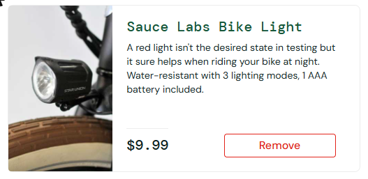

# BUG-027. [Доступность] Элемент в фокусе клавиатуры никак не выделяется

| Поле | Значение |
|---|---|
| Severity | Minor |
| Priority | Medium |
| Модуль | Каталог (доступность) |
| Пользователь | `standard_user` |
| Окружение | Windows 11, Chrome 155, окно 1920×889 |
| URL | https://www.saucedemo.com/inventory.html |
| Дата | 2026-10-12 |
| Воспроизводимость | Всегда |
| Связанный тест-кейс | Чек-лист п. 8.5 |

## Предусловия

- Выполнен вход под `standard_user`, открыт каталог
- В корзине Sauce Labs Bike Light

## Шаги воспроизведения

1. Кликнуть по пустому месту страницы
2. Нажимать Tab, пока фокус не окажется на кнопке Remove у Sauce Labs Bike Light (6 нажатий)
3. Посмотреть на кнопку

## Фактический результат

Кнопка в фокусе выглядит так же, как без фокуса: нет рамки, тени или изменения цвета. Через DevTools:

```
document.activeElement            → button#remove-sauce-labs-bike-light
activeElement.matches(':focus-visible') → true
outline-style: none, box-shadow: none
```

То же для ссылок-изображений товаров (`#item_0_img_link`). Пользователь, который работает с клавиатуры, не видит, где находится.

## Ожидаемый результат

Элемент в фокусе клавиатуры заметно выделен: рамка, тень или изменение цвета (WCAG 2.2, критерий 2.4.7 Focus Visible, уровень AA).

## Вложения



## Дополнительно

Похоже, стиль фокуса отключен через `outline: none` без замены. Затрагивает всех пользователей, которые не пользуются мышью.
