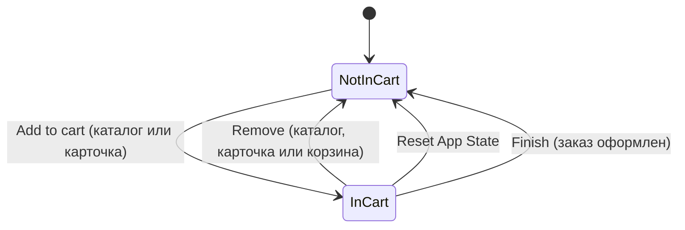
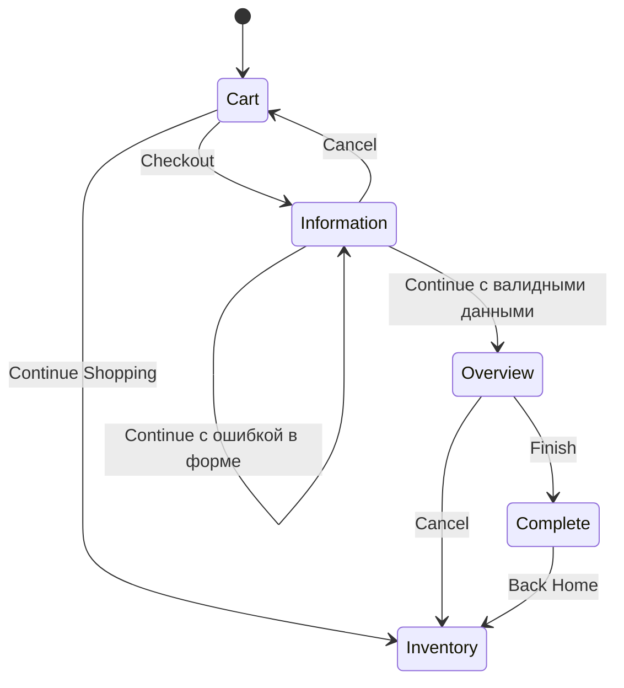

# Тест-дизайн: Swag Labs

Проверить все комбинации входных данных невозможно, поэтому проверки выбираются техниками тест-дизайна: минимальный набор тестов, который покрывает максимум рисков. Ниже четыре техники на примерах из Swag Labs и тест-кейсы, которые из них получились.

## 1. Таблица решений: вход в систему

Результат входа зависит от комбинации трех условий. Каждое правило таблицы становится отдельной проверкой.

| Правило | Username | Password | Ожидаемый результат | Тест-кейс |
|---|---|---|---|---|
| R1 | пусто | любой | «Epic sadface: Username is required» | [TC-LOGIN-03](../test-cases/saucedemo-test-cases.md#tc-login-03-вход-с-пустыми-полями) |
| R2 | заполнен | пусто | «Epic sadface: Password is required» | [TC-LOGIN-04](../test-cases/saucedemo-test-cases.md#tc-login-04-вход-с-пустым-паролем) |
| R3 | существующий | неверный | «Epic sadface: Username and password do not match any user in this service» | [TC-LOGIN-02](../test-cases/saucedemo-test-cases.md#tc-login-02-вход-с-неверным-паролем) |
| R4 | несуществующий | любой непустой | То же сообщение, что в R3 | Чек-лист, раздел 1 |
| R5 | `locked_out_user` | верный | «Epic sadface: Sorry, this user has been locked out.» | [TC-LOGIN-05](../test-cases/saucedemo-test-cases.md#tc-login-05-вход-заблокированного-пользователя) |
| R6 | `locked_out_user` | неверный | То же сообщение, что в R3: система не должна сообщать, что пользователь существует, пока пароль неверный | Чек-лист, раздел 1 |
| R7 | активный пользователь | верный | Открыт каталог | [TC-LOGIN-01](../test-cases/saucedemo-test-cases.md#tc-login-01-успешный-вход-с-валидными-данными) |

R4 и R6 показывают, зачем нужна таблица: без нее легко проверить только «верный» и «неверный» пароль и пропустить комбинации.

## 2. Классы эквивалентности и граничные значения: форма покупателя

Форма Checkout: Your Information содержит поля First Name, Last Name и Zip/Postal Code.

> Требований к формату полей нет. Классы ниже построены на предположении, что почтовый индекс — это 5 или 6 цифр (US ZIP, индекс Узбекистана и России). Расхождение с реальным поведением оформляется как вопрос к требованиям, а не как баг.

### Zip/Postal Code

| Класс | Пример | Ожидание |
|---|---|---|
| Валидный: 5–6 цифр | `10001`, `100000` | Принято |
| Пусто | — | «Error: Postal Code is required» |
| Только пробелы | `␣␣␣` | Ошибка, как для пустого поля |
| Буквы | `abcde` | Ошибка формата |
| Спецсимволы | `!@#$%` | Ошибка формата |
| Слишком короткий | `1234` | Ошибка формата |
| Слишком длинный | `1234567` | Ошибка формата |

Граничные значения длины для диапазона 5–6 цифр: **4, 5, 6, 7** символов.

### First Name и Last Name

| Класс | Пример | Ожидание |
|---|---|---|
| Валидное имя | `Ivan`, `Иван` | Принято |
| Пусто | — | «Error: First Name is required» / «Error: Last Name is required» |
| Только пробелы | `␣␣␣` | Ошибка, как для пустого поля |
| Цифры | `12345` | Вопрос к требованиям |
| Спецсимволы и HTML | `<b>Ivan</b>` | Значение не интерпретируется как разметка |
| Очень длинное значение | 256 символов | Принято с ограничением длины или понятная ошибка, интерфейс не ломается |

Из этих классов получились [TC-CHK-02](../test-cases/saucedemo-test-cases.md#tc-chk-02-пустое-поле-first-name) и [TC-CHK-03](../test-cases/saucedemo-test-cases.md#tc-chk-03-пустое-поле-zippostal-code), остальные классы вошли в [чек-лист](../checklists/saucedemo-checklist.md#5-оформление-данные-покупателя).

**Вопросы к требованиям:** какой формат индекса допустим, есть ли ограничение длины имени, допустимы ли кириллица и цифры в имени.

## 3. Переходы состояний: товар в корзине

У товара два состояния. Проверяются допустимые переходы и то, что все экраны показывают одно и то же состояние.

| Переход | Что проверить | Тест-кейс |
|---|---|---|
| NotInCart → InCart | Кнопка Remove, счетчик +1, товар в корзине | [TC-CART-01](../test-cases/saucedemo-test-cases.md#tc-cart-01-добавление-товара-в-корзину) |
| InCart → NotInCart через корзину | Товар исчез из корзины, в каталоге кнопка Add to cart | [TC-CART-02](../test-cases/saucedemo-test-cases.md#tc-cart-02-удаление-товара-на-странице-корзины) |
| InCart → NotInCart через Reset App State | Счетчик скрыт, кнопки в каталоге сброшены без обновления страницы | [TC-MENU-02](../test-cases/saucedemo-test-cases.md#tc-menu-02-reset-app-state-очищает-корзину) |
| InCart → NotInCart через Finish | После заказа корзина пуста | [TC-CHK-01](../test-cases/saucedemo-test-cases.md#tc-chk-01-успешное-оформление-заказа) |

## 4. Переходы состояний: оформление заказа

**Недопустимые переходы**, которые тоже нужно проверить:

| Переход | Как проверить | Ожидание |
|---|---|---|
| Пустая корзина → Information | Нажать Checkout при пустой корзине ([TC-CHK-05](../test-cases/saucedemo-test-cases.md#tc-chk-05-оформление-заказа-с-пустой-корзиной)) | Оформление не начинается |
| Information → Overview без данных | Открыть `/checkout-step-two.html` напрямую из адресной строки | Обзор не открывается без заполненной формы |
| Не авторизован → любая внутренняя страница | Открыть `/inventory.html` без входа ([TC-LOGIN-06](../test-cases/saucedemo-test-cases.md#tc-login-06-доступ-к-каталогу-без-авторизации)) | Страница входа с сообщением |
